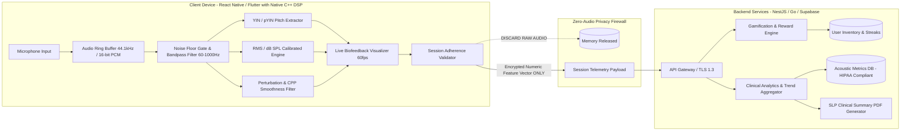
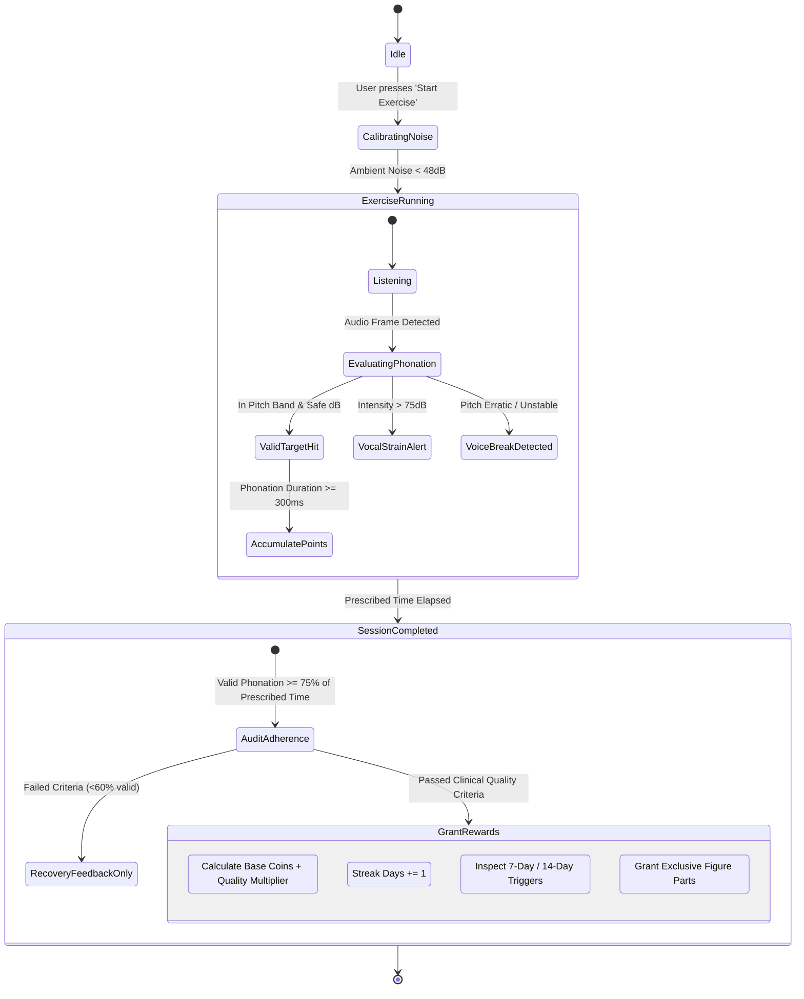
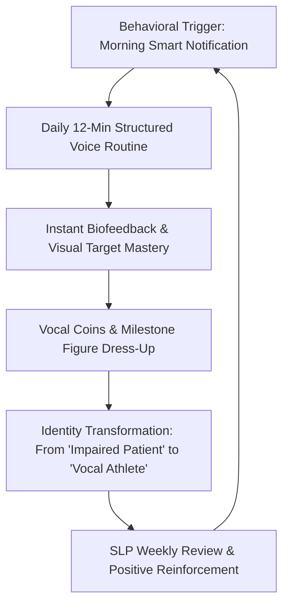

# VoxBloom: Clinical Voice Therapy & Gamified Home Rehabilitation Mobile App
## Comprehensive Product Requirements Document (PRD) & Technical Architecture Specification

---

## 1. Executive Summary & Clinical Rationale

### 1.1 Clinical Background
Post-operative vocal fold patients (e.g., post-microflap surgery for polyps, cysts, or vocal fold nodules) and patients undergoing conservative voice therapy for Muscle Tension Dysphonia (MTD) or vocal paresis face a severe compliance bottleneck:
- **The Problem:** Clinical recovery depends on daily, short-duration (10–20 min) vocal exercises (Semi-Occluded Vocal Tract [SOVT], Yawn-Sigh, Resonant Voice Therapy). However, home compliance plummets below **30%** within two weeks due to isolation, fear of reinjury, lack of immediate feedback, and monotonous repetition.
- **The Solution (VoxBloom):** A patient-centric mobile health application combining **clinical-grade real-time acoustic biofeedback** (Pitch $F_0$, SPL intensity, MPT stability) with **psychologically grounded gamification** (an evolving vocal companion figure customized exclusively through validated clinical adherence).

---

## 2. Information Architecture (IA) & User Journey Map

### 2.1 Information Architecture Tree

```mermaid
graph TD
    AppRoot[VoxBloom App Root] --> Onboard[1.0 Onboarding & Voice Baseline]
    AppRoot --> Home[2.0 Sanctuary / Home Dashboard]
    AppRoot --> Therapy[3.0 Daily Voice Rehabilitation Mode]
    AppRoot --> Studio[4.0 Figure Customization Room / Atelier]
    AppRoot --> Analytics[5.0 Vocal Progress & Clinical Report]
    AppRoot --> Settings[6.0 Clinical Profile & Settings]

    %% 1.0 Onboarding
    Onboard --> VHI[1.1 VHI-10 Vocal Handicap Questionnaire]
    Onboard --> Calib[1.2 Acoustic Mic & Pitch Range Calibration]
    Onboard --> TargetSetup[1.3 Prescription Input / SLP QR Link]

    %% 2.0 Home
    Home --> AvatarView[2.1 3D Companion Figure & Mood State]
    Home --> StreakWidget[2.2 Streak & Daily Goal Indicator]
    Home --> Readiness[2.3 Vocal Fatigue Rating - 5-point Slider]
    Home --> StartCTA[2.4 'Start Today's Session' Primary CTA]

    %% 3.0 Daily Therapy
    Therapy --> Phase1[3.1 Warm-up: Posture & Breathing]
    Therapy --> Phase2[3.2 SOVT: Straw Phonation / Lip Trills]
    Therapy --> Phase3[3.3 Yawn-Sigh Vocal Ease Module]
    Therapy --> Phase4[3.4 Resonant Voice Frontal Focus]
    Therapy --> Phase5[3.5 Cool-down & Instant Adherence Scoring]
    Therapy --> Biofeedback[3.6 Real-Time Live Acoustic HUD]

    %% 4.0 Studio
    Studio --> AvatarDresser[4.1 Wardrobe & Costume Customizer]
    Studio --> RoomDecor[4.2 Sanctuary Decor & Furniture]
    Studio --> AdherenceTrophy[4.3 Clinical Milestone Showcase]

    %% 5.0 Analytics
    Analytics --> TrendPitch[5.1 Weekly Pitch Stability & Range Map]
    Analytics --> TrendMPT[5.2 Maximum Phonation Time Progression]
    Analytics --> TrendAcoustic[5.3 Acoustic Smoothness / CPP Index]
    Analytics --> ClinicianShare[5.4 Encrypted PDF/CSV Export for ENT/SLP]

    %% 6.0 Settings
    Settings --> PushConfig[6.1 Hydration & Vocal Rest Reminders]
    Settings --> MicSens[6.2 Ambient Noise Sensitivity Adjuster]
    Settings --> PrivacyConsent[6.3 HIPAA/GDPR Zero-Audio Storage Controls]
```



---

### 2.2 Patient User Journey Map

| Journey Phase | Clinical Context | Patient Actions & App Touchpoints | Emotional State & Pain Points | Gamification & Retention Mechanics |
| :--- | :--- | :--- | :--- | :--- |
| **1. Trigger & Morning Check-In** | Patient wakes up with morning vocal stiffness. | - Receives smart push notification timed to quiet morning window.<br>- Opens app to see Companion Figure stretching.<br>- Logs Vocal Fatigue Score (1–5) and water intake. | 🥱 Apprehensive about vocal roughness; low motivation. | **Streak protection alert**: "Companion Aria is waiting to warm up with you! Day 12 active." |
| **2. Guided Session Launch** | Prescription: 15 min daily (SOVT + Yawn-Sigh). | - Taps **"Begin Rehab"**.<br>- System performs 5-sec ambient noise calibration.<br>- Video demonstration by certified SLP displays correct technique. | 🎯 Wants clear guidance; fears straining vocal folds. | Clear progress bar (0/4 exercises). Estimated time displayed clearly (12 min remaining). |
| **3. Real-Time Interactive Biofeedback** | Executing Lip Trills and Yawn-Sighs into microphone. | - Sings into mic; target pitch path scrolls horizontally.<br>- Real-time Pitch ribbon shows $F_0$ within the "Safe Green Zone".<br>- Sound level meter stops user if exceeding 72 dB (preventing hyperfunction). | 💡 Immediate visual clarity: "Ah, I'm pressing too hard with my throat, let me relax." | Floating musical particles collect as pitch matches target without strain. Live combo counter. |
| **4. Session Completion & Reward Gate** | Patient completed 12 minutes of clinically valid phonation. | - Acoustic session summary displayed (Pitch stability: 92%, MPT: 14.2s).<br>- Reward drop screen appears with confetti & coin tally.<br>- Level up animation for Companion Figure. | ✨ Accomplished, relieved, confident in vocal progress. | **Guaranteed Reward:** +80 Vocal Coins.<br>**Streak Milestone:** Day 12/14 towards *Golden Resonator Lyre* accessory. |
| **5. Post-Session Engagement & Expression** | Customizing Figure & preparing for rest. | - Visited **Figure Studio**.<br>- Purchases new therapeutic costume part or furniture with earned coins.<br>- Takes snapshot of figure to share on patient community or save to journal. | 🎨 Playful, joyful agency; feeling of ownership over rehabilitation journey. | Items are **unpurchasable with real money**—100% proof of clinical dedication and voice self-care. |
| **6. Clinical Consultation** | Weekly follow-up with ENT / SLP. | - Generates one-tap **SLP Progress PDF** with acoustic variance, compliance rate, and MPT trends. | 🤝 Validated by medical team; clear evidence of recovery. | "Clinical Adherence Badge" shared with therapist for real-world reinforcement. |

---

## 3. UI/UX Wireframe Concepts & Visual Designs

### Visual Screen Designs

| 1. Main Home ("Vocal Sanctuary") | 2. Daily Therapy Mode ("Acoustic Biofeedback HUD") | 3. Figure Customization Room ("Avatar Atelier") |
| :---: | :---: | :---: |
|  |  |  |

---

### 3.1 Screen 1: Main Home ("Vocal Sanctuary")
*Visual Concept: A tranquil, therapeutic space bathed in soft sage greens, deep teals, and calm warm lighting, avoiding clinical starkness.*

```
+-------------------------------------------------------------+
| [Profile]   Aria's Room (Lvl 6)        [🔥 12 Days]  [🪙 540] |
+-------------------------------------------------------------+
|                                                             |
|                    +------------------+                     |
|                    |     ( ˘ ᵕ ˘ )    |  <-- 3D Companion   |
|                    |   /|  OUTFIT  |\ |      Figure "Aria"  |
|                    |    | [Scarf]  |  |      (Breathing     |
|                    |    /          \  |       idle anim)    |
|                    +------------------+                     |
|                   "Your voice feels calmer                  |
|                    today! Let's do SOVT."                   |
|                                                             |
|  [ Morning Vocal Readiness: ● Good (2/5 Tension) ]          |
+-------------------------------------------------------------+
|  TODAY'S CLINICAL PRESCRIPTION                              |
|  Post-Op Vocal Fold Recovery - Day 14                       |
|  ---------------------------------------------------------  |
|  [●] Diaphragmatic Warm-up    (3 min)   COMPLETED           |
|  [ ] SOVT Straw Phonation      (5 min)   PENDING             |
|  [ ] Yawn-Sigh Glides         (4 min)   PENDING             |
|  [ ] Resonant 'M' Humming     (3 min)   PENDING             |
|                                                             |
|  Total Prescribed: 15 Mins | Active Progress: 20%           |
|                                                             |
|  +-------------------------------------------------------+  |
|  |           >>>  RESUME DAILY REHABILITATION  <<<       |  |
|  +-------------------------------------------------------+  |
+-------------------------------------------------------------+
|  [ 🏠 Home ]  [ 🎙️ Therapy ]  [ 👗 Studio ]  [ 📊 Stats ]     |
+-------------------------------------------------------------+
```

#### Key UI Elements:
- **Top Status Bar:** Companion Level, Current Adherence Streak with flame badge, and Vocal Coin balance.
- **Center Stage (The Sanctuary):** Displays the user's custom-dressed avatar in their personalized room. Tapping the avatar triggers a gentle diaphragmatic breathing cycle animation to cue user relaxation.
- **Vocal Readiness Slider:** 5-point validated clinical self-assessment (0 = completely relaxed, 5 = severe strain/pain). If a patient rates $\ge 4$, the app automatically advises a **Vocal Rest Protocol** instead of vigorous exercises.
- **Prescription Action Card:** Shows prescribed tasks synced from clinician or standard clinical protocol, with direct 1-tap entry.

---

### 3.2 Screen 2: Daily Therapy Mode ("Live Acoustic Biofeedback HUD")
*Visual Concept: High-contrast, dark therapeutic mode (reduces visual fatigue) with glowing clinical biofeedback ribbons.*

```
+-------------------------------------------------------------+
| [ < Exit ]   Exercise 2/4: Yawn-Sigh Glide       [ ⚙️ Settings]|
| Target: Easy Onset C3 -> G3 -> C3 Glide   Time: 01:45/03:00 |
+-------------------------------------------------------------+
|                                                             |
|  +---------------------+   +-----------------------------+  |
|  | SLP Demonstration   |   |   CURRENT ACOUSTIC METRICS  |  |
|  | [ Video Mini-Player]|   |   Pitch: 142 Hz (D3)        |  |
|  | Jaw relaxed, easy   |   |   Volume: 64 dB [OPTIMAL]   |  |
|  | vocal sigh          |   |   MPT Stability: 94%        |  |
|  +---------------------+   +-----------------------------+  |
|                                                             |
|  =========================================================  |
|  PITCH (Hz)                                                 |
|  220Hz - - - - - - - - - - - - - - - - - - - - - - - - - -   |
|         . - - .  <--- TARGET GLIDE PATH (Safe Zone)         |
|  165Hz (       )   * * * <--- LIVE PATIENT PITCH TRACE      |
|  130Hz -` . _ . ' - - - - - - - - - - - - - - - - - - - - - |
|  110Hz                                                      |
|  =========================================================  |
|                                                             |
|  SOUND INTENSITY (dB SPL)                                   |
|  [Whisper]  40dB |===== OPTIMAL 60-70dB =====| 85dB [STRAIN]|
|  Live Level: [████████████████░░░░░░░░░░░░░] 64 dB          |
|  Status: 🟢 "Gentle, healthy glottal closure"               |
|                                                             |
|  MAXIMUM PHONATION SUSTAIN (MPT)                            |
|       ( ( (   [   12.4s   ]   ) ) )                         |
|       Smooth airflow ring: Continuous Glow                  |
|                                                             |
+-------------------------------------------------------------+
|  [ ⏸️ Pause ]       [ 🔁 Repeat Demo ]       [ ⏭️ Next Step ] |
+-------------------------------------------------------------+
```

#### Biofeedback Mechanism & Clinical Rationale:
1. **Target Pitch Band vs. Live Trace:**
   - Plots fundamental frequency ($F_0$) over time.
   - Shows a guided "cushion" ribbon. If pitch deviates abruptly (indicating vocal break or hyperfunctional laryngeal jump), the trace color shifts from serene blue-green to amber, prompting an easier breath.
2. **Dynamic Sound Intensity (dB SPL) Meter:**
   - Warns against vocal fold slamming (pressed phonation $>75\text{ dB}$) and against aphonic whispering (which increases shear stress on vocal folds).
3. **MPT Stability Ring:**
   - Measures uninterrupted, stable airflow. Smoothness is calculated using low cycle-to-cycle perturbation.
4. **SLP Video Picture-in-Picture (PIP):**
   - Shows simultaneous physical cues: shoulder drop, abdominal expansion, and forward laryngeal relaxation.

---

### 3.3 Screen 3: Figure Customization Room ("Avatar Atelier")
*Visual Concept: A cozy dressing room and habitat workshop where every cosmetic item represents hard-earned vocal therapy minutes.*

```
+-------------------------------------------------------------+
| [ < Back to Home ]       AVATAR ATELIER             [🪙 540] |
+-------------------------------------------------------------+
|                                                             |
|                       +-------------+                       |
|                       |   ( • ᴗ • ) |  [Rotate 360°]        |
|                       |  /|===👗===|\                       |
|                       |   |   ||   |                        |
|                       |   |   ||   |   Previewing:          |
|                       |   /    \   |   "Resonant Velvet Robe"
|                       +-------------+                       |
|                   [ ✨ Play Voice Sparkle ]                 |
|                                                             |
+-------------------------------------------------------------+
|  CATEGORIES: [ Wardrobe ]  [ Accessories ]  [ Sanctuary Decor ]
+-------------------------------------------------------------+
|  +--------------+  +--------------+  +--------------+       |
|  | [Icon: Robe] |  | [Icon: Straw]|  | [Icon: Scarf]|       |
|  | Silk Robe    |  | Golden Straw |  | Cashmere Wrap|       |
|  | [EQUIPPED]   |  | LOCKED 🔒    |  | Cost: 350 🪙 |       |
|  | Common       |  | 7-Day Streak |  | [Buy Item]   |       |
|  +--------------+  +--------------+  +--------------+       |
|                                                             |
|  +--------------+  +--------------+  +--------------+       |
|  | [Icon: Lyre] |  | [Icon: Tea]  |  | [Icon: Plant]|       |
|  | Acoustic Lyre|  | Warm HoneyTea|  | Healing Fern |       |
|  | LOCKED 🔒    |  | [EQUIPPED]   |  | Cost: 120 🪙 |       |
|  | 14-Day Streak|  | Common       |  | [Buy Item]   |       |
|  +--------------+  +--------------+  +--------------+       |
+-------------------------------------------------------------+
|  CLINICAL PROOF BADGE:                                      |
|  ⭐ "2-Week SOVT Consistency Master" (Equipped on Profile)   |
+-------------------------------------------------------------+
```

#### Gamification Economy Rules:
1. **Zero Pay-to-Win:** No real-money transactions. Items cannot be bought with in-app purchases. Every cosmetic asset is an explicit clinical badge of patient adherence.
2. **Item Tiers:**
   - **Common Items (100–300 Coins):** Standard clothing, warm tea mugs, plants (earned via regular daily task completion).
   - **Adherence Streak Exclusives:**
     - *7-Day Streak:* "Golden Resonance Straw" handheld prop.
     - *14-Day Streak:* "Vocal Cord Angel Wings" aura effect.
     - *30-Day Recovery Champion:* "Full Sanctuary Conservatory" background.
3. **Interactive Audio Playback:** Tapping "Play Voice Sparkle" plays a soothing harmonic chime tuned to the user's calibrated optimal speaking pitch ($F_0$).

---

## 4. System Architecture & Technical Specifications



---

### 4.1 Real-Time Audio Processing Pipeline (On-Device DSP)

To comply with **HIPAA / GDPR health privacy** and ensure **zero-latency audio biofeedback (<30ms)**, all raw audio processing is performed strictly on-device using a low-level native module (C++ via WebAssembly, AudioWorklet, or native iOS CoreAudio/Android Oboe).

#### 1. Audio Ingestion & Pre-Processing
- **Sample Rate:** $44,100\text{ Hz}$, $16\text{-bit monaural PCM}$.
- **Buffer Size:** 1024 samples per frame ($\approx 23.2\text{ ms}$ processing window, $50\%$ overlap).
- **Pre-emphasis & Filtering:** 2nd-order Butterworth bandpass filter ($70\text{ Hz} - 1200\text{ Hz}$) to isolate the human fundamental voice frequencies and eliminate air conditioning hum or phone handling rumbles.

#### 2. Pitch Detection Algorithm ($F_0$)
- Utilizes the **YIN / pYIN algorithm** (Difference Function with Cumulative Mean Normalized Difference, followed by parabolic interpolation).
- **Range:** $65\text{ Hz}$ ($C_2$) to $600\text{ Hz}$ ($D_5$).
- **Sub-harmonic Rejection:** Implements thresholding at $d'(\tau) < 0.1$ to prevent octave errors (common in hoarse, diplophonic, or post-surgical vocal fold vibrations).

#### 3. Sound Intensity (dB SPL) Calculation
$$\text{RMS} = \sqrt{\frac{1}{N}\sum_{n=0}^{N-1} x[n]^2}$$
$$\text{dB SPL} = 20 \log_{10}\left(\frac{\text{RMS}}{\text{Reference}_{\text{calibrated}}}\right)$$
- Includes an auto-calibration step during onboarding measuring room noise floor ($L_{\text{floor}} \approx 35\text{-}45\text{ dB}$).

#### 4. Voice Quality Stability & Anti-Cheat Validation
- **Valid Phonation Gate:** Requires simultaneous periodic pitch lock ($F_0$ certainty $> 0.85$) and intensity above noise floor ($> 50\text{ dB}$) for at least $300\text{ ms}$. This filters out coughs, conversational words, laughs, or background noises.
- **Acoustic Smoothness Index:** Windowed computation of local frequency perturbation:
$$\text{Jitter}_{\text{local}} = \frac{\frac{1}{K-1} \sum_{k=1}^{K-1} |T_k - T_{k+1}|}{\frac{1}{K} \sum_{k=1}^K T_k} \times 100\%$$
- **Cepstral Peak Prominence (CPP) Approximation:** Evaluates harmonic organization vs. turbulent aperiodic noise (breathiness indicator).

---

### 4.2 Gamification & Reward Engine Logic



#### Reward Calculation Algorithm:
```typescript
interface ExerciseSessionResult {
  userId: string;
  prescribedDurationSec: number;
  actualValidPhonationSec: number;
  targetPitchAccuracyRatio: number; // 0.0 to 1.0 (time spent in target safe corridor)
  hyperfunctionEventsCount: number; // instances where dB exceeded safe ceiling
  consecutiveStreakDays: number;
}

function calculateSessionRewards(result: ExerciseSessionResult): {
  coinsEarned: number;
  streakMaintained: boolean;
  unlockedItems: string[];
} {
  // Clinical validity criteria: Must achieve at least 70% valid active exercise
  const adherenceRate = result.actualValidPhonationSec / result.prescribedDurationSec;
  if (adherenceRate < 0.70) {
    return { coinsEarned: 10, streakMaintained: false, unlockedItems: [] };
  }

  // Base coins: 5 coins per valid exercise minute
  const baseCoins = Math.floor(result.actualValidPhonationSec / 60) * 5;

  // Quality multiplier (pitch stability reward)
  const qualityMultiplier = 1.0 + (result.targetPitchAccuracyRatio * 0.5); // up to +50%

  // Strain penalty: Deduct bonus if patient shouted or strained vocal folds
  const strainPenalty = Math.min(result.hyperfunctionEventsCount * 2, 15);

  // Streak Multiplier
  let streakMultiplier = 1.0;
  if (result.consecutiveStreakDays >= 14) streakMultiplier = 1.5;
  else if (result.consecutiveStreakDays >= 7) streakMultiplier = 1.25;

  const totalCoins = Math.max(
    5,
    Math.round((baseCoins * qualityMultiplier - strainPenalty) * streakMultiplier)
  );

  // Milestone Item Unlock Checks
  const unlockedItems: string[] = [];
  const nextStreak = result.consecutiveStreakDays + 1;
  if (nextStreak === 7) unlockedItems.push('item_straw_prop_gold');
  if (nextStreak === 14) unlockedItems.push('item_robe_resonant_velvet');
  if (nextStreak === 30) unlockedItems.push('room_sanctuary_conservatory');

  return {
    coinsEarned: totalCoins,
    streakMaintained: true,
    unlockedItems
  };
}
```

---

### 4.3 Database Schema (PostgreSQL / Supabase DDL)

```sql
-- 1. Patient Profile & Clinical Parameters
CREATE TABLE patient_profiles (
    id UUID PRIMARY KEY DEFAULT gen_random_uuid(),
    auth_user_id UUID UNIQUE NOT NULL,
    vocal_pathology_type VARCHAR(64) NOT NULL, -- e.g., 'post_op_polyp', 'MTD', 'vocal_nodules'
    post_op_date DATE,
    baseline_f0_hz NUMERIC(5,2) NOT NULL,     -- Baseline fundamental frequency
    target_pitch_min_hz NUMERIC(5,2) NOT NULL, -- Prescribed target range lower bound
    target_pitch_max_hz NUMERIC(5,2) NOT NULL, -- Prescribed target range upper bound
    safe_db_ceiling NUMERIC(4,1) DEFAULT 75.0, -- Warning threshold for hyperfunctional strain
    created_at TIMESTAMPTZ DEFAULT NOW(),
    updated_at TIMESTAMPTZ DEFAULT NOW()
);

-- 2. Daily Clinical Prescription
CREATE TABLE therapy_prescriptions (
    id UUID PRIMARY KEY DEFAULT gen_random_uuid(),
    patient_id UUID REFERENCES patient_profiles(id) ON DELETE CASCADE,
    exercise_type VARCHAR(48) NOT NULL,        -- 'sovt_straw', 'yawn_sigh', 'resonant_hum', 'glides'
    daily_target_duration_sec INT NOT NULL,    -- e.g., 300 sec (5 min)
    repetitions_per_day INT DEFAULT 2,
    active_until DATE NOT NULL,
    created_at TIMESTAMPTZ DEFAULT NOW()
);

-- 3. Telemetry Session Logs (Zero-Audio Privacy Compliant)
CREATE TABLE session_logs (
    id UUID PRIMARY KEY DEFAULT gen_random_uuid(),
    patient_id UUID REFERENCES patient_profiles(id) ON DELETE CASCADE,
    prescription_id UUID REFERENCES therapy_prescriptions(id),
    session_start TIMESTAMPTZ NOT NULL,
    session_end TIMESTAMPTZ NOT NULL,
    prescribed_sec INT NOT NULL,
    valid_phonation_sec INT NOT NULL,
    mean_pitch_f0_hz NUMERIC(5,2),
    mean_intensity_db NUMERIC(4,1),
    pitch_accuracy_pct NUMERIC(4,1),           -- % within safe target corridor
    mpt_sustained_max_sec NUMERIC(4,2),        -- Maximum Phonation Time recorded
    hyperfunction_strain_count INT DEFAULT 0,  -- Count of excessive dB threshold bursts
    pre_session_fatigue_score INT CHECK (pre_session_fatigue_score BETWEEN 1 AND 5),
    adherence_valid BOOLEAN NOT NULL,
    created_at TIMESTAMPTZ DEFAULT NOW()
);

-- 4. Gamification State & Inventory
CREATE TABLE gamification_states (
    patient_id UUID PRIMARY KEY REFERENCES patient_profiles(id) ON DELETE CASCADE,
    current_streak_days INT DEFAULT 0,
    longest_streak_days INT DEFAULT 0,
    last_completed_date DATE,
    coin_balance INT DEFAULT 0,
    character_level INT DEFAULT 1,
    character_xp INT DEFAULT 0,
    equipped_outfit_id VARCHAR(64) DEFAULT 'default_tunic',
    equipped_accessory_id VARCHAR(64) DEFAULT 'none',
    equipped_room_theme_id VARCHAR(64) DEFAULT 'tranquil_garden',
    updated_at TIMESTAMPTZ DEFAULT NOW()
);

-- 5. Unlockable Reward Item Catalog
CREATE TABLE item_catalog (
    item_id VARCHAR(64) PRIMARY KEY,
    category VARCHAR(32) NOT NULL,             -- 'outfit', 'accessory', 'room_decor'
    name VARCHAR(128) NOT NULL,
    description TEXT,
    rarity VARCHAR(24) NOT NULL,               -- 'common', 'rare', 'clinical_milestone'
    coin_price INT DEFAULT 0,                  -- 0 if unlocked exclusively via streak
    required_streak_days INT DEFAULT 0,        -- Milestone condition
    asset_bundle_uri VARCHAR(256) NOT NULL
);

-- 6. User Inventory Junction Table
CREATE TABLE patient_inventory (
    id UUID PRIMARY KEY DEFAULT gen_random_uuid(),
    patient_id UUID REFERENCES patient_profiles(id) ON DELETE CASCADE,
    item_id VARCHAR(64) REFERENCES item_catalog(item_id),
    unlocked_at TIMESTAMPTZ DEFAULT NOW(),
    unlock_source VARCHAR(48) NOT NULL,        -- 'coin_purchase', 'streak_reward', 'slp_assigned'
    CONSTRAINT unique_patient_item UNIQUE (patient_id, item_id)
);
```

---

## 5. Retention & Behavioral Habit-Formation Strategy



### 5.1 Habit-Formation Mechanics
1. **Implementation Intentions & Dynamic Scheduling:**
   - Rather than static alarms, notifications leverage smart time-window triggers (e.g., 20 minutes post-waking, following initial vocal hydration).
2. **Loss Aversion with "Vocal Rest Shield":**
   - Streak freeze mechanic: If a patient has acute inflammation, vocal fatigue score $\ge 4$, or physician-mandated vocal rest, they can activate a **"Vocal Rest Day"**. This preserves their streak without forcing them to phonate and risk tissue reinjury.
3. **Weekly Acoustic Transformation Report:**
   - Visual comparison charts showing jitter reduction, MPT expansion from 8s to 16s, and stable $F_0$ distribution. Quantifiable recovery evidence prevents patient drop-off during weeks 3–6.

---

## 6. Regulatory, Clinical Safety & Data Security

1. **HIPAA & GDPR-Health Safeguards:**
   - **Zero Audio Storage Guarantee:** Raw waveform data is never written to disk or transmitted across the network. Audio resides in volatile RAM ring buffers and is immediately overwritten. Only privacy-preserving scalar metrics ($F_0$, dB, duration, perturbation) are synced.
2. **Clinical Safety Ceilings:**
   - Immediate audio-visual lockout if vocal strain exceeds safe limits for more than 3 consecutive attempts, alerting the user: *"Take a sip of water, swallow easily, and rest for 5 minutes before continuing."*
3. **Clinician Tele-Monitoring Portal:**
   - Treats the app as a Software as a Medical Device (SaMD) companion, allowing authorized SLPs to view adherence dashboards and adjust target pitch envelopes remotely via encrypted clinician access.
